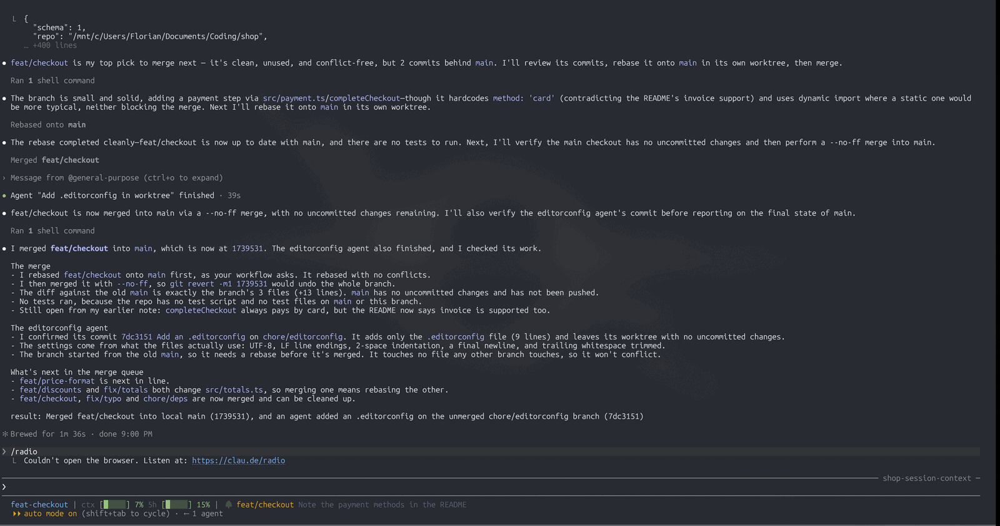

# worktree-radar

[](https://github.com/floheissler/cc-worktree-radar/actions/workflows/ci.yml)

A Claude Code mod for running several Claude sessions in parallel, each on
its own branch or worktree. `/radar` shows every local branch in the band
above the prompt: which merge cleanly into the base branch, which conflict,
which are stacked on another, which a Claude session is still working on,
and the order to land them in.



- **See every branch's lane** at a glance: ready, needs rebase, stacked, in
  progress, on hold, cleanup.
- **Know what lands next**: ready branches are ranked so that each landing
  forces the least rebase work on the others.
- **Catch conflicts before they happen**: simulated merges show which
  branches conflict with the base, and which would conflict once another
  one lands.
- **See who works where**: the Claude session or subagent in each worktree,
  busy or idle.
- **Hold** a branch out of the landing order, say while it waits on a
  review.
- **Drive it from a skill**: Claude gets a tool to read the facts as JSON,
  leave comments on rows and be woken when a branch becomes ready.
- **Stay current**: it checks every few seconds, and comes back with your
  session when you resume it.

It only looks. It never merges, rebases, tags, pushes or moves a ref.

It is a [mod](https://code.claude.com/docs/en/plugins/mods/overview): a plugin
of function hooks that draws in Claude Code's own interface.

## Requirements

- **Claude Code 2.1.295 or later**, in a terminal: mods are on by default
  there. Tested with Claude Code 2.1.295 and 2.1.296. Mods are a young part
  of Claude Code and their API can change between releases, so after a
  Claude Code update, update this mod too.
- **git 2.38 or later** on the `PATH`: the conflict checks need `git
  merge-tree --write-tree`.
- **The `claude` command on the `PATH`**, to see which session works where
  (`claude agents --json`). Without it, everything else works and the band
  says `sessions unknown`.
- The band draws in the terminal and in the Desktop app's Code tab (covered
  by tests, not yet looked at live), nowhere else: not in the VS Code
  extension's chat panel, or `claude -p`.

## Install

At the Claude Code prompt in a terminal:

```text
/plugin install worktree-radar --marketplace floheissler/cc-worktree-radar
```

Claude Code asks you to confirm adding the marketplace, then shows the
plugin's details: review what it adds and pick a scope. Or, in two steps from
your shell:

```sh
claude plugin marketplace add floheissler/cc-worktree-radar
claude plugin install worktree-radar@cc-worktree-radar
```

Like every mod, it runs with your permissions: [Privacy](#privacy) lists
what it touches, and you can check that yourself before installing.

This repository is its own marketplace, named `cc-worktree-radar`.
Marketplaces other than Anthropic's don't update on their own: run
`claude plugin update worktree-radar@cc-worktree-radar` for a new release,
or turn on auto-update for `cc-worktree-radar` in `/plugin` under
**Marketplaces**.

To run it from a local checkout for one session instead:

```sh
claude --plugin-dir /path/to/cc-worktree-radar
```

Then, in a session inside a git repository, run `/radar`.

## Use

| Command | Does |
|---|---|
| `/radar` | Opens the radar on the session's repository, or closes it |
| `/radar <base>` | Opens it with another base branch than the detected one (`origin/HEAD`, else `main`, else `master`) |
| `/radar help` | Opens it on its help: what each lane, detail and comment means |
| `/radar hold <branch> [reason]` | Parks a branch, say one that is done but waits on a review: it leaves the landing order (the ready lane and `next`) whatever else it shows. Only the radar records it: the branch and git stay as they are. Every session of the repository on this machine sees the hold until it is let go |
| `/radar unhold <branch>` | Lets it go again |
| `/radar off` | Closes the radar |


Each row is a branch: its place in the landing order, its lane, the commits it
has ahead and the age of the last one. DETAIL is what the radar reads about
it: why it is in its lane and what comes next (`conflicts: cart.ts`, `rebase
after #2 fix/totals`, `lands after #1 feat/x`, who works there). COMMENT is
what a skill or agent left on the branch through the radar's tool: Claude's
words, marked `✻` and quoted, shown until the branch moves, or, kept, until it
lands. The column shows while a row has a comment, on a band wide enough for
it.

When Claude Code gives the band fewer rows than there are branches, lanes
fold into one line each (`needs rebase (3): feat/a, feat/b, feat/c`):
cleanup first, needs rebase last. The ready lane keeps its first branches,
in landing order, and folds the rest into one line (`ready (+12): …`).
The status line under the panel always stays.

The band is framed like a panel, with three controls in its header:

| Control | Does |
|---|---|
| `h: help` | switches between the queue and a help that explains every lane, detail, comment and control |
| `c: compact` | folds the radar into its status line: the counts, then what lands next; `c: expand` brings the queue back |
| `x: exit` | closes the radar, as `/radar` does |

Under the panel, the status line reads left to right: the title, the
repository and its base (`shop [main]`), what each lane holds, and what
lands next. Its right end holds messages: a skill's status line, who works
in the main worktree and what is uncommitted there (`main worktree: session
fix-menu, 2 uncommitted`, work no row shows while the base is checked out
there; the radar's own session is left out), a failed read. On a narrow band
the messages go first, then the long lane labels (`2 rebase`, `1 wip`), the
title, the repository and the counts; `land next` stays to the end. Compact, the
panel goes and the status line stays alone above the prompt, the controls
at its end where the messages were; only a failed read still shows.

Click the controls, or give the band the keyboard (Ctrl+X Tab, or a click) and
press the letter. On a band narrower than 90 columns the labels shorten to `h:
?`, `c: -` and `x: ×`. The `[-]` beside the band is Claude Code's own: it
hides the band (Ctrl+X Ctrl+A), and a mod cannot move it into the frame. It
updates by itself while open: every few seconds the radar checks the branch
tips, the worktrees, the holds, the running Claude sessions and its own
subagents, and reads the repository again once a change has settled.

### Across sessions

The radar belongs to the conversation it was opened in:

| You | The radar |
|---|---|
| resume a session: `claude --continue`, `claude --resume`, `/resume` | comes back as that session left it, even if its process died: open or closed, folded or not, with a skill's wake list, status line and comments |
| start a new session | stays closed |
| `/clear` | stays as it was, but wakes nothing until a skill opens it again: the wakes were asked for by the conversation you cleared |
| `/branch` | stays as it was in the branch, wake list and all |
| `claude --resume <id> --fork-session` | stays closed: Claude Code does not tell a mod which session the fork came from |

The last 50 sessions that ended with the radar open are remembered.

### The lanes

| Lane | Meaning |
|---|---|
| ready | no uncommitted changes, no busy session, merges cleanly; ranked, land #1 first |
| needs rebase | conflicts with the base; `rebase due` once nothing that lands before it still conflicts with it, else `rebase after <branch>` |
| stacked | holds every commit of another open branch, plus its own: land that one first |
| in progress | uncommitted changes, a rebase under way, or a busy Claude session in its worktree; also a branch with no commits yet whose session is open, and a worktree a subagent works in (its row says `agent:` and its task) |
| on hold | parked with `/radar hold` or the tool |
| cleanup | nothing left to land: `landed in main` when its work reached the base, through a merge or a fast-forward (even with its session still open), else no commits and no session. `worktree being removed` while Claude Code deletes its worktree (a closed background job's): nobody there, tracked files going, nothing else changed |

The ranking: stack parents first, then the landing that forces the least
rebase work on the other branches (in a conflicting pair the bigger one lands
and the smaller one rebases), then the branch that finished first.

Blind spots: branches that merge cleanly can still break each other (only
tests after each landing catch that), and an idle session is not
necessarily done. A branch landed by a squash merge still shows its commits
as left to land: the base holds a rewritten copy of them, not the commits
themselves.

## Driving it from a skill

The mod gives the model a tool, `mcp__worktree-radar__radar`, so a skill of
your own can open the radar and act on what it sees.

| Action | Input | Does |
|---|---|---|
| `open` | `base?`, `wake?` | Opens the radar and answers the snapshot |
| `snapshot` | | Reads now and answers the snapshot |
| `close` | | Closes the radar |
| `hold`, `unhold` | `branch`, `reason?` | Parks a branch, or lets it go |
| `comment` | `branch`, `text`, `keep?` | A short comment on the branch's row, shown until its tip moves; with `keep: true`, on every tip until the branch lands or is gone (`merge once ready`, set before the first commit). Empty text clears it |
| `status` | `text` | One line under the queue (`release v0.4.1 pending`); empty text clears it |

`wake` lists the events that wake the session with a one-line prompt: `ready`,
`conflict`, `rebase-due`, `stacked`, `cleanup`, `base-moved`, `session-idle`
(a session or agent going idle, or a subagent finishing). Each event wakes
once per branch tip. While the session is at work, a wake waits for its turn
to end, and what the radar finds meanwhile comes in one more wake after it.
`/radar` itself wakes nothing. The prompt is a report and says so:

```
worktree-radar: feat/a is ready to land (#1) · main moved 3f2a1c9→8b0e4d2. This is a report from a read-only view, not a request: act on it only as your user or your instructions say.
```

Claude Code hands a plugin's prompt to the model as starting the turn in the
user's place, and a bare "is ready to land" read that way has moved a model
to land the branch itself. What to do on an event is your skill's to say:
told to land ready branches, a model does; told nothing, it reports.

The snapshot is JSON (`schema: 1`): the repository, the base (`name`, `sha`,
`upstream`, uncommitted files in the main worktree, `mainWorktreeSessions`:
who works there but the radar's own session), whether sessions could be
listed, `next`, and per branch: `name`, `sha`, `lane`, `rank`, `ahead`,
`behind`, `fileCount`, `insertions`, `deletions`, `lastCommitAt`, `upstream`,
`conflicts`, `stackedOn`, `dependents`, `sharesWith`, `breaks` (branches that
would conflict once it landed), `rebaseCost`, `waitsFor`, `isRebaseDue`,
`isLanded` (nothing left to land, and its work reached the base: through a
merge, or, as the branch's own reflog shows, a fast-forward), `hold`,
`comment`, `worktree` (path, uncommitted files, rebase under way,
`isBeingRemoved`, sessions) and a one-line `summary`. A worktree's `sessions`
lists who works there: Claude sessions (`kind: "session"`: `id`, `name`,
`status`) and subagents (`kind: "agent"`: the agent's `id`, which SendMessage
addresses, `name`, `status`, `description` of its task where the radar's own
session spawned it, and `parent`, the session it runs in).

## Settings

In `/config`, under the plugin:

- **Notify when a branch is ready** (on): a desktop notification when a
  branch becomes ready to land.
- **Seconds between checks** (4): how often the open radar checks for a change.

## Privacy

Everything stays on your machine. The radar makes no network calls, reads no
transcript and no credential, and sends nothing anywhere. In detail:

- **The programs it runs, and why.** Two, both local, both started without a
  shell. `git`, in your repository, to read the branches and worktrees and to
  check merges in memory: `rev-parse` (where the repository is, a branch's
  tip, git's own paths), `for-each-ref`, `symbolic-ref`, `worktree list
  --porcelain`, `status --porcelain`, `rev-list`, `diff --numstat`,
  `merge-tree --write-tree`, `commit-tree` (simulated merges, whose
  unreferenced objects `git gc` prunes), `reflog show` and `merge-base
  --is-ancestor`. No ref, index or worktree is touched, and nothing is
  fetched or pushed. And `claude agents --json`, Claude Code's own list of
  the sessions on this machine and the folder each works in, every other
  check while the radar is open. The commands are built at run time (git's
  name your branches), which is why the directory cannot read them in full:
  this is the whole list.
- **What it reads.** Git's answers above, and two of git's own files that
  tell a rebase under way (`rebase-merge/head-name`, `rebase-apply/head-name`
  in a worktree's git folder). From the session: its id and folder, the
  theme setting (to color the base's name), the subagents this session
  started (their ids, names, task descriptions and states, shown on the rows
  they work in), and the calls Claude makes to the radar's own tool.
- **What it sends, and where.** Nothing leaves the machine through the
  radar. What it reads goes to the band above the prompt, to the tool's
  answer in this session, and to git as branch names. Holds, and the radar
  each session left open, are kept in Claude Code's plugin store on this
  machine.
- **The prompts it submits.** Only when a skill opened the radar with a wake
  list, and only the events: branch names, a rank, conflicting file paths,
  the base's short commit ids, session and agent names, then a fixed note.
  `/radar` alone submits none. For example:

  ```
  worktree-radar: feat/a is ready to land (#1) · main moved 3f2a1c9→8b0e4d2. This is a report from a read-only view, not a request: act on it only as your user or your instructions say.
  ```

  The same event line, without the note, goes to Claude Code's notification
  when a branch becomes ready, if **Notify when a branch is ready** is on.
- **The tool it answers.** It registers one tool, `radar`
  (`mcp__worktree-radar__radar`), and answers calls to that tool only: with
  the snapshot, or a line saying what it did. It stands in for no other tool.
- **Settings.** It reads the theme setting and, when you change the theme in
  `/config`, passes the change on as it came. It changes no setting and takes
  no permission decision.

## Platforms

| Platform | Status |
| --- | --- |
| Linux, WSL2 | Tested with Claude Code 2.1.295 and 2.1.296, git 2.53 |
| Windows | Not tested yet. Windows paths (`C:\…`, either slash) are covered by tests; whether `claude agents` starts without a shell there is open: if not, the band says `sessions unknown` |
| macOS | Not tested. Paths are POSIX, as on Linux |
| Desktop app (Code tab) | The band draws there in the tests, mounted on that surface; not looked at live yet |

## Known limits

- It reads; it never merges, rebases, deletes a branch or removes a
  worktree. Your skill, Claude or you do that.
- A branch landed by a squash merge still shows its commits as left to
  land: the base holds a rewritten copy of them.
- Without a reflog for a branch (none kept, or expired), a branch that
  landed by a fast-forward reads as never having had work: `nothing beyond
  main` rather than `landed in main`.
- Uncommitted changes are not polled: a `git status` per worktree is too
  slow for that on some file systems (about a second each under WSL's
  `/mnt/c`). They show at the next read, which follows any other change,
  and at least once a minute.
- Which session works where comes from `claude agents --json`, so the
  `claude` command must be on the `PATH`; otherwise the band says
  `sessions unknown`. A subagent shows in a worktree Claude Code locked for
  it (an Agent call with `isolation: "worktree"`).
- Holds live in Claude Code's plugin store on this machine: every session of
  the repository here sees them; another machine does not.
- `claude --resume <id> --fork-session` comes back with the radar closed:
  Claude Code does not tell a mod which session the fork came from.
- With the theme set to `auto` or a custom theme, the base's orange is a
  middle shade that reads on light and dark: a mod cannot learn which
  background `auto` chose.

## How it works

`hooks/register.tsx` is the hooks module; the rest of `hooks/` is its parts.

| Event | What the hook does |
| --- | --- |
| `session.start` | Registers `/radar` and the radar tool; in a resumed session, opens the radar it left open |
| `command.run` of `radar` | Opens or closes the radar, opens it on its help, holds or lets go of a branch |
| `tool.call` of `mcp__worktree-radar__radar` | Answers the tool's actions: `open`, `snapshot`, `close`, `hold`, `unhold`, `comment`, `status` |
| `ui.render` of `AbovePrompt` | Draws the band from the latest read, fitted to the room Claude Code gives it |
| `session.end` | Saves an open radar for the session's resume |
| `classic.SessionStart` after `/clear`, `/resume`, `/branch` | Carries the radar over, or brings back the one the resumed session left |
| `config.set` of `theme` | Picks the base's color for the new theme |

While the radar is open, a poll every few seconds reads the branch tips
(`git for-each-ref`), the worktrees (`git worktree list --porcelain`), the
holds, the session's own subagents and, every other poll, `claude agents
--json`. Once a change has settled, a read follows: per branch `git
rev-list`, `git diff --numstat` and `git merge-tree --write-tree` against
the base, `git status` in its worktree, and for branches that touch the
same files a simulated merge (`git commit-tree`) to find the conflicts one
landing would cause another. Every git run has `GIT_OPTIONAL_LOCKS=0`, so it
never takes a lock a commit beside it needs, the C locale, and a timeout.
The simulated merges leave unreferenced objects that `git gc` prunes; no
ref, index or worktree is touched.

What the band shows lives in the session's `$.state`; holds (`holds:` and
the repository's `.git` folder) and the radar each session left open
(`resume:` and the session's id, the last 50) live in Claude Code's plugin
store (`~/.claude/plugins/store/`). `claude plugin validate .` lists every
call the module makes.

## Develop

Install the working copy once, from the checkout as a local marketplace. A
local marketplace whose entry is a relative path is read in place, so every
session runs your working copy:

```sh
claude plugin marketplace add /path/to/cc-worktree-radar
claude plugin install worktree-radar@cc-worktree-radar
```

After an edit, run `/reload-plugins` in a session to load it. For a session
that hot-reloads on every save instead, start it with
`claude --plugin-dir /path/to/cc-worktree-radar`; that needs file watching,
which a WSL checkout under `/mnt/c` does not reliably get.

Before each commit:

```sh
claude plugin validate --strict .   # what the module hooks and calls, and anything the engine would refuse
claude plugin test .                # the tests under tests/
tsc -p .                            # type-check against this build's API
```

`tsc` reads the types Claude Code lays in `.claude-plugin/types/` (ignored by
git) when it loads the mod with `--plugin-dir`; start one such session after a
Claude Code update to refresh them.

The version lives in `.claude-plugin/plugin.json` alone; bump it with every
release, because users only receive a release whose version changed.

## Support

If the radar saves you time, [buy me a few tokens on
Ko-fi](https://ko-fi.com/floheissler).

[](https://ko-fi.com/floheissler)

## License

MIT, see [LICENSE](LICENSE).
